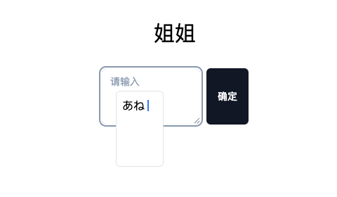
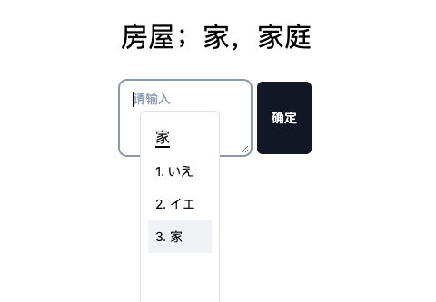

# 日语学习工具

使用 Timeless 0.34.2 的日语学习网页，保留假名发音、手写识别、日文输入、单词挑战、绘图管理和账户功能。

## 启动

```bash
pnpm install --frozen-lockfile
pnpm dev
```

打开 http://127.0.0.1:3102。也可以使用 `npm ci` 和 `npm run dev`。

```bash
pnpm check
pnpm test
pnpm build
pnpm preview
```

登录和注册沿用 `/api/admin/user/login`、`/api/admin/user/register`，需要原来的后端服务。学习页面保持原有的免登录访问行为。

## 功能与路由

| 路径 | 功能 |
| --- | --- |
| `/home/index` | 五十音、浊音、拗音表，点击播放本地发音 |
| `/home/hiragana` | 听音、手写、OCR 识别、候选字确认与进度 |
| `/home/word` | 原有 15 个词汇的随机挑战，支持汉字或假名答案 |
| `/home/drawing` | 查看旧绘图记录、删除、刷新及 ZIP 下载 |
| `/home/analysis` | 句子输入及原有固定示例的分词、读音和中文解释 |
| `/login`、`/register` | 原有登录、注册流程 |

导航栏保留首页、平假名挑战和单词挑战三个入口；绘图管理和句子分析仍可通过原路径访问。页面切换时保留输入和挑战进度。

输入罗马字时显示假名组合。`Tab` 打开汉字/片假名候选，方向键选择，`[`、`]` 翻页，空格或回车确认，`Esc` 取消；确认后再按回车提交单词答案。




本地缓存继续使用 `localStorage.global`，保留 `user` 和 `canvas` 数据结构，无需清除或迁移旧数据。词典、发音、OCR worker、识别模型继续使用 `public/` 中的原文件。

## 修改页面

`src/pages/` 中每个有状态页面由 `*.model.js` 和 `*.js` 组成：Model 持有业务状态、行为和 UI Core，View 使用 Timeless 组件渲染并调用 Model。公共渲染组件位于 `src/components/`，原有 TypeScript 业务核心继续位于 `src/biz/`、`src/domains/`。

`src/timeless.js` 初始化全局 Timeless API；节点配置通过 `attributes.n` 声明语义名称，并同时提供 `data-n` 用于定位。组件卸载时清理订阅、定时器和 OCR worker。

## 更新 Timeless

`vendor/timeless/` 保存从本机 Timeless 仓库复制的 ESM 构建产物、样式、许可证和带 SHA-256 的来源清单。项目构建使用该快照，不需要访问本机外部目录。

上游构建完成后执行：

```bash
pnpm sync:timeless /Users/mayfair/Documents/other/timeless
pnpm test
pnpm build
```

省略路径时使用上述目录。同步脚本只读取上游，不修改 Timeless 仓库；迁移规范见该仓库的 `.claude/skills/timeless/SKILL.md`。
